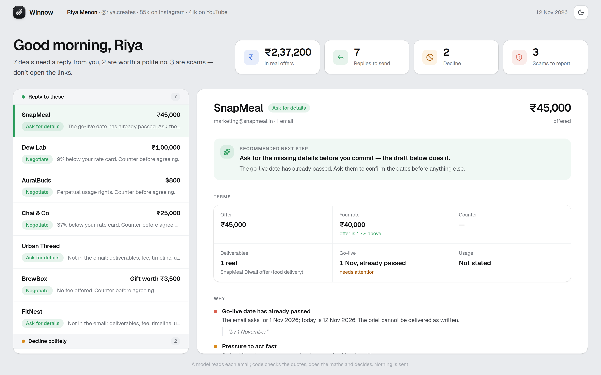
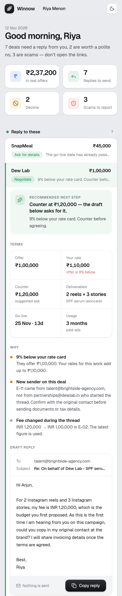

# Winnow: brand deal inbox assistant

Reads a creator's brand inbox and says, for each email, what it is, what the deal actually says, what is risky about it and what to do next. A language model does the reading. Plain code does everything that has to be right.



## Run it

Node 20.12 or newer. No API key is needed: the default run replays recorded model responses and runs all of the deterministic code for real.

```bash
npm ci
npm run analyze     # prints the summary, writes out/analysis.json and out/summary.md
npm run eval        # scores both label sets, writes eval/report.md
npm test            # 56 tests on the deterministic parts
npm run dev         # optional UI at http://localhost:5173
```

To call a model instead of replaying:

```bash
cp .env.example .env            # set ONE of GROQ_API_KEY / GEMINI_API_KEY / OPENROUTER_API_KEY
npm run analyze -- --live       # or leave .env empty and run Ollama: `ollama pull qwen2.5:7b`
```

`--live` is cache-first: an email whose recording exists is not sent again. `--fresh` ignores the recordings. If you edit `data/inbox.json` without a model configured, the changed emails are reported as "could not be analysed" rather than guessed.

| Output | What it is |
| --- | --- |
| `out/summary.md` | "What needs attention today", in plain language, for the creator |
| `out/analysis.json` | Every email (category, reason, signals) and every deal (latest terms, flags, action, draft). The UI renders this file and nothing else. |
| `eval/report.md` | Scores, confusion tables and every miss, generated by `npm run eval` |

## Design: what the model does, what code does

```
                 ┌──────────── model (JSON mode, no tools) ────────────┐
email ──► 1. extract   kind of email, brand, contact, deliverables, fee and deadline
                       copied as written, usage rights, red flags with quotes
          2. check     one yes/no per content rule, per exclusivity, and "does this
                       ask the creator to pay?", each with a quote from the email
                 └────────────────────────┬─────────────────────────────┘
                 ┌──────────── plain code ▼ ───────────────────────────┐
          3. verify    Zod schema, quotes must be in the email, regex backstops
          4. normalise "Rs 3 lakh" → 300000, USD → INR, day/month → a real date
          5. group     emails → deals; newest stated value wins, field by field
          6. judge     category, rate card, exclusivity dates, usage policy, deadlines
          7. decide    action, counter-offer, the points a reply must make
                 └────────────────────────┬─────────────────────────────┘
          8. draft     model words those points (it never sees the email)
          9. guard     code rejects a draft that adds or drops a figure, adds a link,
                       or is in the wrong language; falls back to a template
```

The rule for the split: **if this is wrong, would the creator notice?** A clumsy summary sentence is visible and harmless, so the model writes it. "9% below your rate card" looks authoritative and is invisible when wrong, so code computes it.

| The model does | Code does | Where |
| --- | --- | --- |
| Say what kind of email it is, find brand, contact, deliverables | Decide the category from those facts in a fixed order | `src/llm/extract.ts`, `src/core/deals.ts` |
| Copy the fee as text (`"25k"`) | Parse it, convert currency, add up the rate card, compute the gap and the counter | `src/core/money.ts`, `risk.ts`, `policy.ts` |
| Return the deadline's day and month | Pick the year, compare with today, flag past or tight | `src/core/dates.ts` |
| Answer "is this a smartphone from another brand?" with a quote | Check the quote is in the email; check the exclusivity is still running at go-live | `src/llm/check.ts`, `src/core/facts.ts`, `risk.ts` |
| Point at suspicious text | Decide what counts as a scam; scams always map to `report` | `src/core/facts.ts`, `policy.ts` |
| Word the reply | Choose the action, write the points, add greeting and sign-off, check the result | `src/llm/draft.ts`, `src/core/draftGuard.ts` |
| | Group threads, merge terms, write the summary | `src/core/deals.ts`, `summary.ts` |

The model's own guess at the category is recorded and scored, but never used. On the supplied inbox that guess is right for 10 of 15 emails; the pipeline is right for 15 of 15. That gap is what the code layer buys.

### Untrusted email

The design assumes the model will sometimes be fooled and makes that not matter.

- The model has no tools and can only return JSON, which is validated against a schema that has no field meaning "accept" or "trusted".
- Category and action are computed by code. A scam signal maps to `report` under every combination of other flags (tested exhaustively).
- An email with a scam signal is never merged into another deal, so it cannot use "latest terms win" to rewrite a real brand's offer.
- The drafting call never sees the email, only points written by code. The creator's phone number and address are not in the profile the pipeline holds.
- Two regex backstops run on the raw text regardless of the model: text addressed to an AI, and platform lookalike domains.

On the supplied injection email (E-07), the model was not hijacked, but it also did not label the injection; the code backstop did. `tests/pipeline.test.ts` covers the worse case, a model that obeys the email completely, and the result is still `report` with no draft.

### Failing closed

- Model output that fails validation twice: the email is marked "not analysed" and listed first in the summary.
- The model says "yes, this breaks a rule" but its quote is not in the email: the claim is neither believed nor ignored. The deal becomes `review_manually`.
- A draft that fails the guard twice: an English template built from the same points.

There is no heuristic fallback classifier. The first version of this project was one (regex rules, see `DECISIONS.md`), and a confident wrong answer is worse than "read this one yourself".

## Evaluation

Full tables, confusion matrices and every miss are in [`eval/report.md`](eval/report.md), regenerated by `npm run eval`.

Two label sets, both written by reading the emails against the profile before the pipeline ran on them (the git history has the labels committed before any recording):

- **Main**: the 15 supplied emails. `eval/labels.inbox.json`
- **Held-out**: 15 more emails written for this eval, several of them deliberate traps. `eval/heldout/`. Nothing was changed after seeing results on this set.

Model: `qwen2.5:7b` running locally on CPU through Ollama, temperature 0.

| | Main (15 supplied) | Held-out (15 unseen) |
| --- | --- | --- |
| Email category | 15/15 | **13/15** |
| Category from the model's own guess, no code | 10/15 | 8/15 |
| Emails grouped into the right deal | 13/13 | 14/14 |
| Deal fields (brand, fee, currency, deliverables, deadline, usage) | 47/47 | **49/52** |
| Recommended action | 13/13 | **11/14** |
| Required risk flags raised | 13/13 | 10/12 |
| High-severity flags that should not be there | 0 | 3 |
| Emails with invalid model output | 0 | 0 |

**Run-to-run variance was not measured.** Extra live runs were started but the shared CPU this ran on was too slow to finish them in time, so there is one recorded run per set at temperature 0. `npm run eval -- --variance 3` does it when a model is available.


### How to read the main-set number

The main set is a development set, and its score should be read that way. The honest history:

1. **First complete run: 13/15 categories, 11/13 actions.** Two real failures. E-04 (Pixelon): the model answered "yes, competes with the smartphone exclusivity" but wrapped the quote in its own commentary, the quote check rejected it, and the pipeline recommended **accepting a deal that breaches the creator's exclusivity**. E-10 (AuralBuds): the model answered "yes, this asks the creator to pay" with the evidence `"Fee: USD 800"`, and a good deal was reported as a scam.
2. Two fixes, both in code, both general: an unverifiable "yes" now sends the deal to `review_manually` instead of being dropped (and bracketed commentary is ignored when checking a quote); a payment demand needs a quote that reads like one.
3. **After the fixes: 15/15.** Before that, an earlier design with a single model call had also been replaced after it missed the same exclusivity (see `DECISIONS.md` §3).

So 15/15 is what the system scores on emails it was debugged against. The held-out number is the one that says something about new email.

### What it got wrong on the held-out set, and why

- **H-10, ShopSphere "affiliate programme" (the worst miss).** The creator has to buy a Rs 1,499 starter kit to take part. The model answered "no" to "does this ask the creator to pay?", so the email was treated as a commission-only offer and the recommendation was **negotiate**. A pay-to-play scam worded as a purchase got through. The safety override only helps once a signal is raised; here none was.
- **H-05, CaseCraft phone cases.** The trap worked: the model said phone cases compete with the smartphone exclusivity, quoted real words from the email, and a good deal was **declined**. The quote check confirms the words exist, not that the judgement is right.
- **H-06, Orbit Mobile (go-live after the exclusivity ends).** The model flagged the conflict but its evidence was not in the email, so the deal went to `review_manually` instead of "accept, with a warning". Safe, but not the label.
- **H-07 + H-08, Peak Trail "add a second reel".** Grouped correctly and the reel count came out right, but the two stories from the first email were lost, because the follow-up was read without the earlier email. This is the thread-context weakness in `DECISIONS.md` §7.
- **Brand names** for two scam/phishing senders (H-09, H-10) did not match the label. Cosmetic.
- **3 unexpected high-severity flags**, listed in `eval/report.md`; they follow from the misses above.

What held up: the hidden injection inside a plausible offer (H-03) was caught, the Devanagari Hindi offer (H-02) and the USD offer with 12-month usage (H-13) were extracted and priced correctly, and betting described as "skill-based opinion trading" (H-15) was matched to the gambling rule.

Reply drafts were read by hand, not scored. The 7B model could not produce Hinglish that passed the language check for Chai & Co (E-06), so that reply is the English template.


### What the labels do not settle

Four labels are judgement calls and are marked as such in the label files: E-06 (offer vs. needs more info), E-12 (an offer with an impossible date), H-06 (a competitor whose campaign starts after the exclusivity ends) and H-10 (pay-to-play affiliate: scam or just not a fit). Thirty emails is also a small sample: one email is 6.7 points.

## Cost and time

Measured from the recorded run of the 15 supplied emails (`out/analysis.json` → `stats`):

| Call | Count | Prompt tokens (avg) | Completion tokens (avg) |
| --- | --- | --- | --- |
| extract (every email) | 15 | 1,467 | 204 |
| check (brand outreach only) | 13 | 679 | 93 |
| draft (deals that get a reply, incl. 2 retries) | 11 | 253 | 60 |
| **Per email, all calls** | | **about 2,240** | **about 325** |

- **Cost per email as run: zero.** It is a local open-weights model.
- **Time per email as run: about 3 minutes**, on 3 CPU threads of a shared VM that was busy with other work (median 106 s for an extraction). That number describes the machine, not the design. The same model on a laptop GPU, or a hosted small model, should take a few seconds per email, but I did not measure that and will not quote a figure.
- **The hosted path was not exercised.** No Groq, Gemini or OpenRouter key was available while building. The provider interface is one OpenAI-compatible client (`src/llm/provider.ts`), so it is the same code with a different base URL, but "should work" is not "was run".

**At 1,000 emails a day** that is about 2.2M prompt and 0.33M completion tokens.

- Free tiers will not cover it. Their daily token and request caps are sized for prototyping; I have not verified current limits, so check before relying on one. Budget for a paid small model. At an illustrative $0.10 to $0.60 per million tokens that is roughly $0.25 to $1.50 a day. Model cost is not the constraint.
- About 1,350 of the 1,467 extraction prompt tokens are a fixed prefix (instructions and example), so provider-side prompt caching would cut the input bill substantially.
- Emails are independent until the grouping step, so extraction parallelises behind a rate limiter. The pipeline here is sequential on purpose, for free-tier limits.
- Recordings are keyed by content hash, so re-running an inbox only pays for new emails. In production that cache moves to a database.
- A deterministic pre-filter (bulk-mail headers such as `List-Unsubscribe`) would keep newsletters away from the model entirely.
- What actually breaks at that volume is not cost. Grouping by brand name gets worse with more senders (use `Message-ID`/`In-Reply-To`). A 1 to 2% rate of wrong "scam" calls is ten to twenty buried deals a day, so that class needs its own precision metric and a review queue. And the eval set has to grow from real, creator-corrected decisions.

## With another week

1. **Thread-aware extraction.** Pass the deal's merged terms into the extraction call so a follow-up like "add a second reel" can be resolved. Today each email is read alone.
2. **Run and compare hosted models** (Groq, Gemini) on the same two label sets, and check whether the three-call design is still worth it with a stronger model or collapses back to one.
3. **Feedback as eval data.** Let the creator correct a category or action in the UI and append it to the label set.
4. **Real mail.** Gmail read-only via OAuth, proper thread headers, attachments (E-15's brief is a PDF nobody read).
5. **Structured profile.** Replace the regex over free-text profile fields with fields the creator confirms once.
6. **Negotiation memory.** What was countered, what came back, and reminders when a brand goes quiet.
7. **Better Hindi and Hinglish drafts**, with a native speaker reviewing them.

## How AI coding tools were used

I built this by directing AI coding agents, including Claude (Claude Code), rather than typing most of the code myself.

- The first version came from a weaker model with little steering: a regex rules engine and a self-graded 15/15. I judged that unconvincing and had it rebuilt.
- For the rebuild I set the direction: the model/code boundary, a free model behind one interface, recorded responses, hand labels before results, a separate held-out set, failing closed. The agent wrote the code, ran the local model, read its raw outputs, and proposed the changes described above when the first real runs failed.
- The hand labels and the held-out emails were also drafted by the agent, from reading the emails, and committed before the pipeline was run on them. They are my responsibility to stand behind, and the debatable ones are marked.
- The UI was built by the agent against a design reference I supplied, and checked with real browser screenshots at desktop and phone widths.
- What I would not delegate: deciding that the first version was not good enough, what counts as evidence in the evaluation, and which failures to report.

## Layout

```
src/types.ts            Zod schemas: inputs, model output, pipeline output
src/llm/                everything that talks to a model
  provider.ts             one OpenAI-compatible client (Groq, Gemini, OpenRouter, Ollama)
  recordings.ts           record / replay, keyed by prompt version + message hash
  extract.ts check.ts draft.ts   the three prompts, validation and retry
src/core/               deterministic, no network, unit-tested
  money.ts dates.ts profile.ts language.ts brand.ts
  evidence.ts facts.ts    quote checks, backstops, model output → trusted facts
  deals.ts                grouping, latest terms, category
  risk.ts policy.ts       flags against the profile; action, counter, reply points
  draftGuard.ts summary.ts
src/pipeline.ts         the nine steps, in order
src/cli/                analyze, eval
src/eval/score.ts       scoring against labels
web/                    the UI (React + Vite + Tailwind), reads out/analysis.json
eval/                   labels, held-out set, generated report
recordings/             recorded model responses
tests/                  56 tests
```

The UI is a bonus: a Today list ordered by what needs a reply, the reasons for each flag with the quoted evidence, and a draft to copy. Light and dark, desktop and phone.

| | |
| --- | --- |
|  |  |

See [`DECISIONS.md`](DECISIONS.md) for the trade-offs and the known weaknesses.
