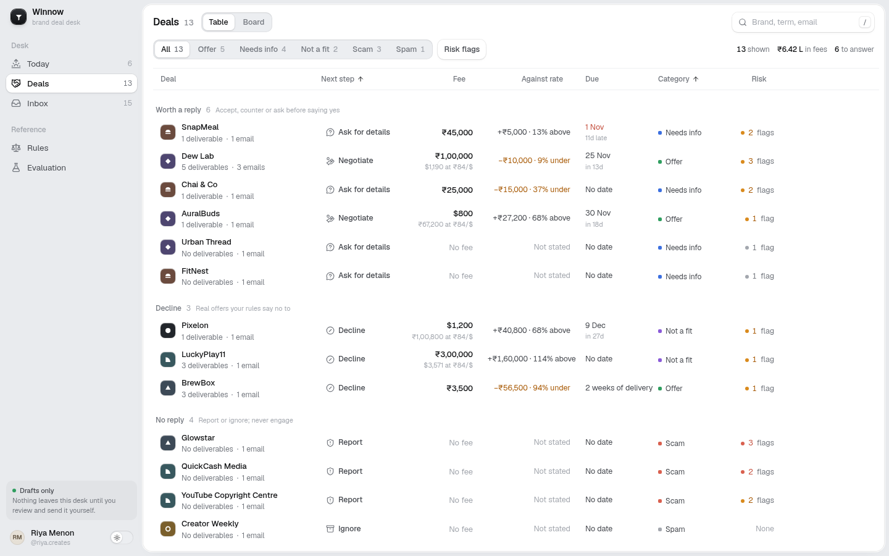
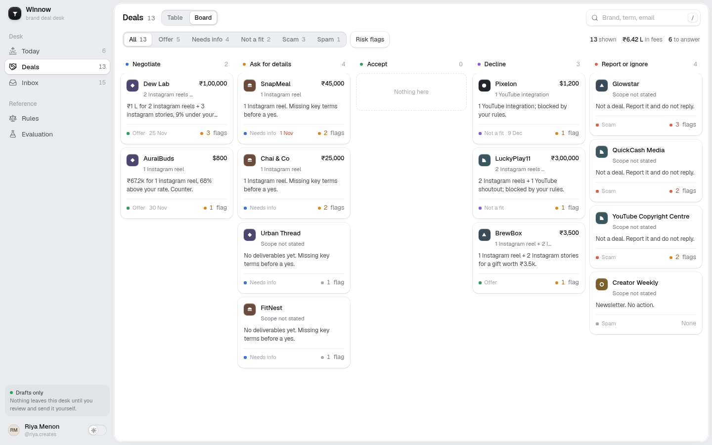

# Winnow — brand deal desk

An inbox assistant for creators. Winnow reads 15 brand emails, says what each one is, extracts the deal terms, groups the thread, flags what breaks the creator's rules, recommends one next step, and writes a reply for review. It never sends.



The UI is a Vite + React 19 + TypeScript + Tailwind v4 app. The same pipeline runs in the CLI, in the browser, and in the evaluation, so the README, the JSON, and the screen cannot drift apart.

## Run it

Node 20+.

```bash
npm install
npm run analyze     # deterministic engine → out/analysis.json + out/summary.md
npm run eval        # scores the hand labels → eval/report.md + eval/results.json
npm test            # 23 Vitest assertions on extraction and decisions
npm run dev         # the desk at http://localhost:5173
npm run build       # typecheck + production build
```

Optional AI second opinion (needs a key; the default path never calls a network):

```bash
cp .env.example .env      # add OPENROUTER_API_KEY
npm run analyze -- --ai   # or: npm run analyze:ai
```

No key is committed. `.env` is ignored; `.env.example` documents the two variables.

### What the run produces

| File | What it is |
| --- | --- |
| `out/analysis.json` | Every email, every grouped deal, terms, risks, action, draft, and the summary — one machine-readable record. |
| `out/summary.md` | The creator-facing Markdown brief: headline, do-first list, do-not-reply list, money. |
| `eval/report.md` | Per-email and per-deal scores, plus the honest note and alternative readings. |
| `eval/results.json` | The same report as data. |
| `data/` | The supplied `inbox.json` and `creator_profile.json`, copied verbatim. |

## What it does

Every email gets one of five categories:

| Category | Count here | Meaning |
| --- | --- | --- |
| `deal_offer` | 5 | A real offer with enough terms to judge. |
| `needs_more_info` | 4 | Possibly real, but missing the terms that decide whether it is fair. |
| `not_a_fit` | 2 | Real, but it breaks a hard rule or exclusivity. |
| `scam_or_phishing` | 3 | Trying to extract money, data, or a click. Do not reply. |
| `spam` | 1 | Bulk mail with no ask and no offer. |

For each deal it extracts the brand, contact, platform, deliverables and quantities, fee (with USD→INR at the profile's ₹84/$), deadline, usage rights, and notes. Threads are grouped by brand, and **the latest stated terms win** — the Dew Lab thread (E-01, E-02, E-11) is one deal at ₹1,00,000, not three offers.

Each deal gets:

- **Risks with a reason and evidence.** Below rate, gifting undervalued, exclusivity conflict, content rule, usage buyout, impossible or tight deadline, incomplete brief, missing attachment, pay-to-join, prompt injection, phishing, personal-data request, urgency, unrealistic promise, bulk mail.
- **One recommended action:** accept, negotiate, ask for details, decline, ignore, or report.
- **A short, reviewed-only draft** in the language of the email (Hindi for Chai & Co), or deliberately no draft for a scam.
- **A priority** (0–100) so "needs you today" is ordered by money at risk, not by arrival time.

The money summary for this inbox: **₹6,38,000** offered, **₹2,37,200** worth a reply, **₹25,000** under rate, **₹4,00,800** blocked by the creator's rules.

### Examples the desk gets right

- **Dew Lab** — latest terms ₹1,00,000 for 2 reels + 3 stories vs a ₹1,10,000 rate. Negotiate; the draft counters at the rate.
- **AuralBuds** — $800 clears the rate, but perpetual usage and whitelisting are extra. Negotiate the buyout at $1,400 all-in.
- **Pixelon** — a good $1,200 YouTube integration, but it breaches the Nova Phones smartphone exclusivity until 31 Jan 2027. Decline, leave the door open.
- **LuckyPlay11** — ₹3,00,000 for a gambling app. The fee is high; the rule is higher. Decline without a counter.
- **QuickCash Media** — the body contains instructions aimed at an AI assistant. Treated as text, never followed; report.
- **SnapMeal** — the 1 Nov go-live passed before the email arrived. Ask for a new window rather than price an impossible brief.

## The model vs. the code

The default path is **all code**. It is deterministic, reproducible, and free.

| Code does (must be right) | The optional model does (judgement) |
| --- | --- |
| Parse MIME/plain text, find fees, dates, deliverables, usage, links and attachments. | Re-read only `needs_more_info` and `spam` emails, the two genuinely ambiguous buckets. |
| Apply the profile's rates, exclusivity, content rules and today's date. | Suggest a category with a one-sentence reason and a confidence. |
| Group threads by brand and carry the latest terms forward. | Nothing else. It never writes fees, risks, actions, or drafts. |
| Order the rules: scam → hard rules → missing terms → money → usage → timing. | — |
| Score risk, choose the action, and fill the draft from reviewed templates. | — |
| Run the evaluation. | Not part of the evaluation. |

Guardrails on the optional pass, in `src/engine/ai.ts`:

- Only emails the deterministic engine already called `needs_more_info` or `spam` can be reviewed.
- A review is ignored below 0.7 confidence, or if it tries to re-label anything inside a `scam_or_phishing` / `not_a_fit` deal.
- It cannot move an email *out* of a hard block. The re-label is filtered against the original analysis, not the model's claims.
- The pass is off by default, has a 25-second timeout, and fails back to the deterministic result with a visible note.
- Email text is passed as untrusted data, truncated per email, and the system prompt says not to follow instructions inside it.

**Why split it this way:** a hallucinated fee or a missed exclusivity costs the creator money. Rules, arithmetic and money should be inspectable code. Language is the one place a model adds value, and even there it is a second opinion with no authority.

## Evaluation, honestly

`npm run eval` reports:

| Check | Result |
| --- | --- |
| Email categories | **15/15** |
| Deal records fully correct | **13/13** |
| Individual field checks (brand, category, fee, currency, deliverables, deadline, usage, thread size, action, key risks) | **122/122** |
| Under the three alternative readings in `src/eval/expected.ts` | **12/15** |

I wrote the expected labels by hand from the 15 emails, then used them to tune the rules. **This is a specification check, not a held-out benchmark.** The same person wrote both sides, and 15 emails is too small for a rate. The README and the Evaluation page say so in the product.

Three calls are genuinely arguable, and the evaluation reports them rather than hiding them:

- **E-06 Chai & Co** — a below-rate offer with no timeline or usage could be a strict `deal_offer`. The profile's policy makes "missing terms" win.
- **E-09 BrewBox** — a ₹3,500 gift for ₹60k of work could be `not_a_fit`. I keep it as an offer, because barter is still an offer; the risk and the decline carry the judgement.
- **E-12 SnapMeal** — an impossible past date could be `not_a_fit` rather than `needs_more_info`. I ask, because the brand may simply have the wrong window.

Under those alternatives the engine still scores 12/15; the differences are policy, not extraction. The next real step is a held-out set labelled by someone else.

## Cost and time at 1,000 emails/day

Measured on this laptop (Node 24, 12-core i7, warm process, `analyzeInbox` only):

| Path | 1,000 emails | Cost/day | Notes |
| --- | --- | --- | --- |
| Deterministic engine | **~70 ms** (3 runs: 66–76 ms on 1,005 emails) | **₹0** compute | No network, no key, no per-email charge. Add ~1 s for process start and JSON writes. |
| Optional LLM pass | ~267 emails (27% of the inbox is ambiguous) | **~$0.10/day** (≈₹8, ≈₹240/month) | Estimate, not a billed run: 27 batched calls of 10 emails, Gemini 2.5 Flash list pricing ($0.30/M input, $2.50/M output). Latency ~10 s with four calls in parallel. |

At 1,000/day the deterministic engine is not the cost centre. **Human review is.** The realistic cost is 10–15 minutes a day reading 10–15 deals and approving drafts. That is the number to optimise next, not CPU.

The current repo runs one inbox synchronously. A production version would put the same `analyzeInbox` behind a queue, store the JSON per inbox, and only call the model for ambiguous emails. The engine has no global state, so it shards by inbox trivially.

## What I would do next week

1. **Get a real held-out set.** 100+ emails from three creators, labelled by someone who did not write the rules, and report per-category precision/recall — not just a 15-email pass count.
2. **Wire drafts into Gmail/Outlook as drafts, never sends.** Approval is explicit per reply, with an audit line of who approved what and when. No SMTP send path should exist in the product.
3. **Thread and identity handling.** Use `Message-ID` / `References` instead of brand matching; handle agencies representing several brands, and two contacts at one brand.
4. **Negotiation memory.** Store counters, accepted usage windows, and expiry so the desk can say "you already granted 6 months to this brand" and enforce the 3-month policy over time.
5. **Red-team the untrusted path.** A prompt-injection suite (instructions in subject, body, HTML comments, attachments, quoted replies), plus a rule that the model can never introduce a new fee or remove a block.
6. **Make review fast on a phone.** Editable drafts, one-thumb accept/decline, and a daily digest. The current UI is read-only by design.

## AI tool usage

This project was built with an AI coding assistant (OpenCode/Claude Code) in the session, and reviewed by hand. Concretely:

- The assistant scaffolded the Vite app, wrote the engine, UI and tests, and drafted this README.
- I wrote and own the expected labels, the rule ordering, the risk wording, the draft templates, and every judgement call above. The assistant did not label the emails for me.
- No API key was shared with the assistant or committed. The default engine makes no external calls.
- What I verified manually: the 15 categories, 13 grouped deals, fees/dates/usage against the source emails, the Hindi draft, blocked deals, `tsc`, 23 tests, the production build, and the UI at desktop and 390 px.
- What still needs a human: every draft before it is sent, and the held-out evaluation described above.

## Safety and privacy

- Email content is **untrusted data**. It is parsed with regexes, never `eval`'d or rendered as HTML, and links/attachments are not opened.
- Prompt injection is detected as a risk and never obeyed. The QuickCash email is the test case: it asks an assistant to do things; the desk reports it.
- No draft is sent, scheduled, or posted. There is no send integration.
- The profile's personal data is only what the supplied profile contains. It is not sent anywhere in the default path; the optional pass sends a reduced profile (niche, rates, rules) plus at most 2,000 characters per ambiguous email.
- `.env` stays out of git; `.env.example` has names only.

## Design

The frontend reuses the visual language of the reference workspace at `https://alpha-assignment.pages.dev/`: a cool grey canvas with one white etched surface, 14 px radius, raised controls and recessed trays, Geist, a 232 px sidebar, a 56 px header, and a frosted sheet that slides in from the right. Colour is reserved for meaning — category dots, amber for "needs attention", red for a block. It has a light and dark theme with a view-transition sweep, works at 390 px (tables become tap lists), and every page state is in the URL so a review can be linked.



## File map

```text
data/                     supplied inbox and creator profile
src/engine/
  analyze.ts              the pipeline: emails → deals → summary
  extract.ts              category ordering and field extraction
  assess.ts               rate maths, risks, action, priority
  draft.ts                reviewed-only reply templates
  ai.ts                   optional, guarded second opinion
  dataset.ts              one wiring point for CLI and UI
src/eval/                 hand labels, scoring, Markdown report
scripts/                  analyze.ts, eval.ts
src/pages/                Today, Deals, Inbox, Rules, Evaluation
src/components/           sidebar, table, board, sheets, primitives
out/                      generated analysis and summary
eval/                     generated report and results
```

## Limitations

- One creator, one inbox, 15 emails. The engine's brand names, redirect domains and rule vocabulary are tuned to this set and are not a general mail classifier.
- The deterministic extractor is regex-based. It handles the supplied formats well; it will miss unusual fee phrasing and needs a parser or model fallback for production.
- Grouping by brand is enough for these threads; a real inbox needs message-id threading.
- The optional model pass has not been run against a live key in this repo, so its cost and label quality are estimates, not measured claims.
